<div align="center">

# 🚌 ALU Transport

**Live campus bus information for ALU students and drivers.**

Know where the bus is, how many seats are left and when it reaches your stop, without calling anyone.


Group 17 · Mobile Application Development · African Leadership University, Kigali

</div>

---

## Table of contents

1. [The problem](#the-problem)
2. [What the app does](#what-the-app-does)
3. [Screenshots](#screenshots)
4. [Demo video](#demo-video)
5. [Architecture](#architecture)
6. [State management](#state-management)
7. [Database design (ERD)](#database-design-erd)
8. [Security](#security)
9. [Getting started](#getting-started)
10. [Testing and code quality](#testing-and-code-quality)
11. [How we worked as a team](#how-we-worked-as-a-team)
12. [Team](#team)
13. [Known limitations and next steps](#known-limitations-and-next-steps)

---

## The problem

ALU students who live off campus take the school bus from five pickup points: Remera, Kimironko, Kacyiru, Kicukiro and Gisozi. In our user research, students told us they often wait at the stop without knowing if the bus has left campus, if it is delayed, or if it is already full. Many call or text the driver while he is driving, and some miss the last round.

ALU Transport fixes this. The driver taps one button ("Leaving campus", "At pickup point", "Delayed", "Bus full"...) and every student sees the new status at once, with the bus position on the route and the time it will reach their stop.

## What the app does

### For students

| Feature | Details |
|---|---|
| Sign in | Email and password with email verification and password reset, or Google sign-in. The session stays after the app restarts. |
| First-time setup | Choose a role and a pickup point once. |
| Live home | Live status card, minutes until the bus reaches your stop, seats left, and a warning when it is the last round of the day. |
| Live route map | Today's route with all stops and a bus marker that moves after each driver update. Works in portrait and landscape. |
| Rounds and seats | Today's morning and evening rounds with seats left, and a "Remind me" switch for each round. |
| Alerts | Every driver update with the time it was sent, swipe to delete, and an in-app banner when a new update arrives. |
| Request update | Ask the driver for an update with one tap and see his reply on the home screen. |

### For drivers

| Feature | Details |
|---|---|
| Approved drivers only | A driver account is only accepted if the email is on the transport office's driver list. |
| One-tap updates | Six preset updates (Leaving campus, At pickup point, Delayed, Bus full, Round ended, No more rounds) with an optional short note. |
| Manage rounds | Create, edit and delete today's rounds (time, stops, number of seats). |
| Seats and requests | Change seats left with a stepper, mark the bus full, and answer students' requests with a quick reply. |

### For everyone

| Feature | Details |
|---|---|
| Profile | Generated avatar that you can shuffle, edit name, change pickup point (students), sign out. |
| Settings | Light, dark or system theme, large text, 24-hour time and alert banners. Saved on the phone with SharedPreferences. |
| Responsive layout | Bottom navigation bar in portrait and a navigation rail in landscape and on wide screens. |

## Screenshots

<table>
  <tr>
    <td align="center">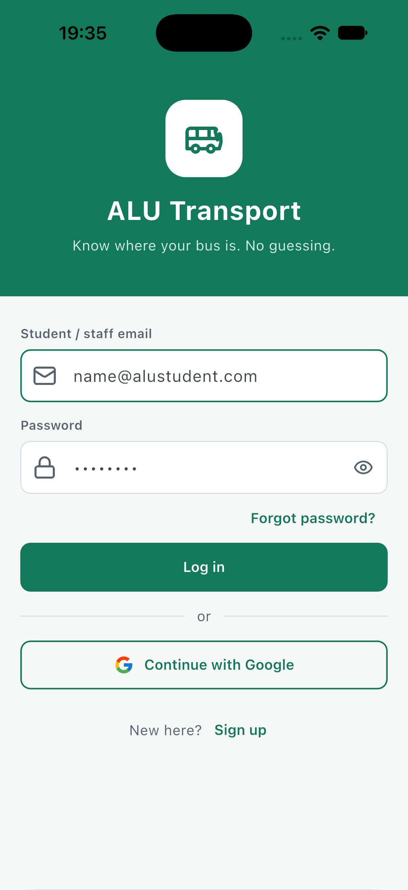<br><sub>Login</sub></td>
    <td align="center">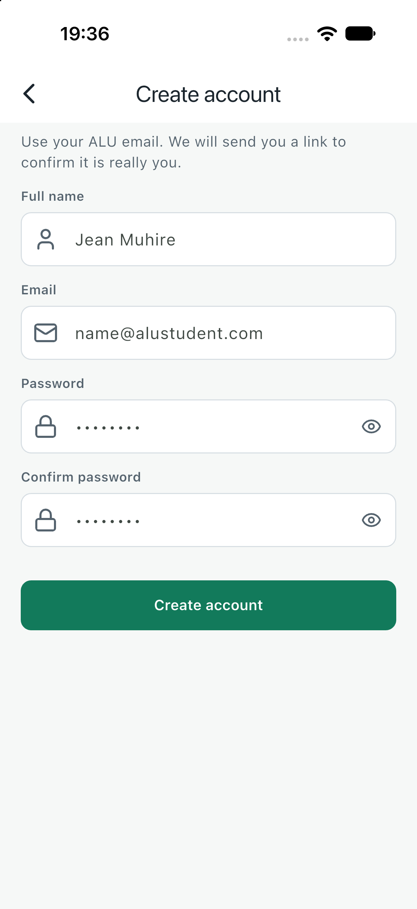<br><sub>Register</sub></td>
    <td align="center">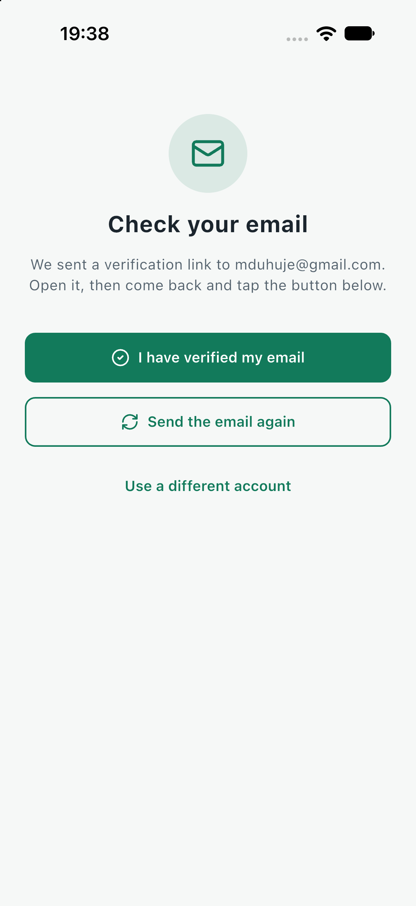<br><sub>Verify email</sub></td>
  </tr>
  <tr>
    <td align="center">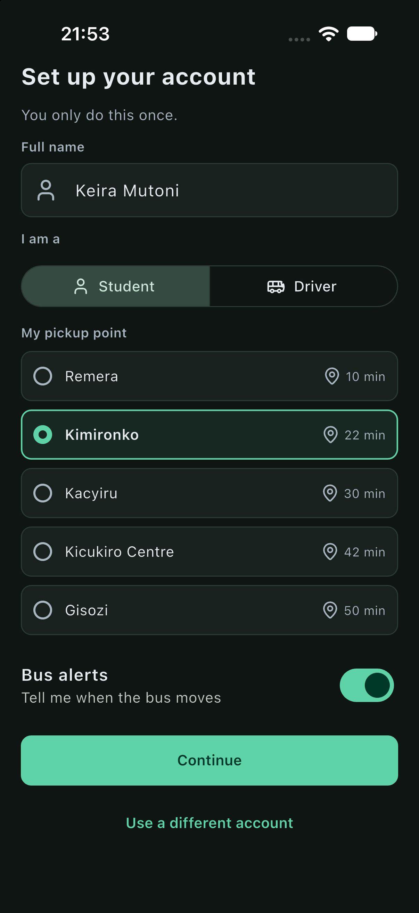<br><sub>Setup (student)</sub></td>
    <td align="center">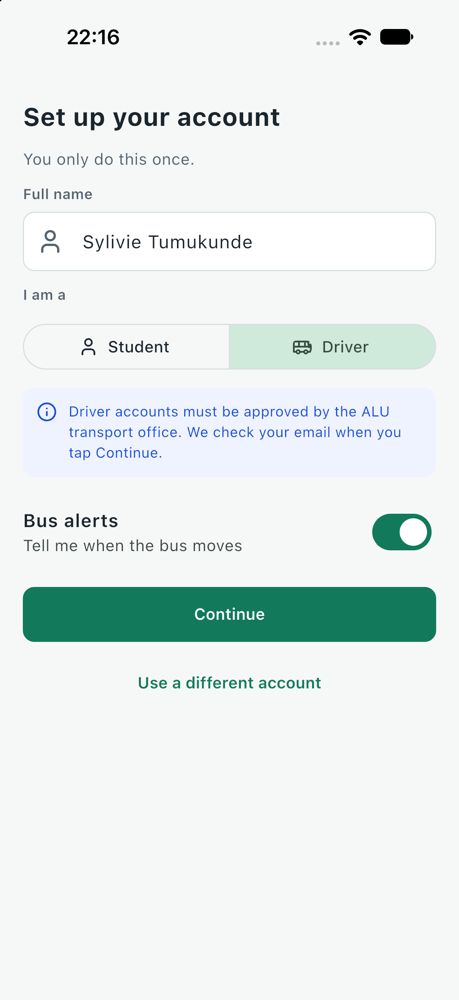<br><sub>Setup (driver)</sub></td>
    <td align="center">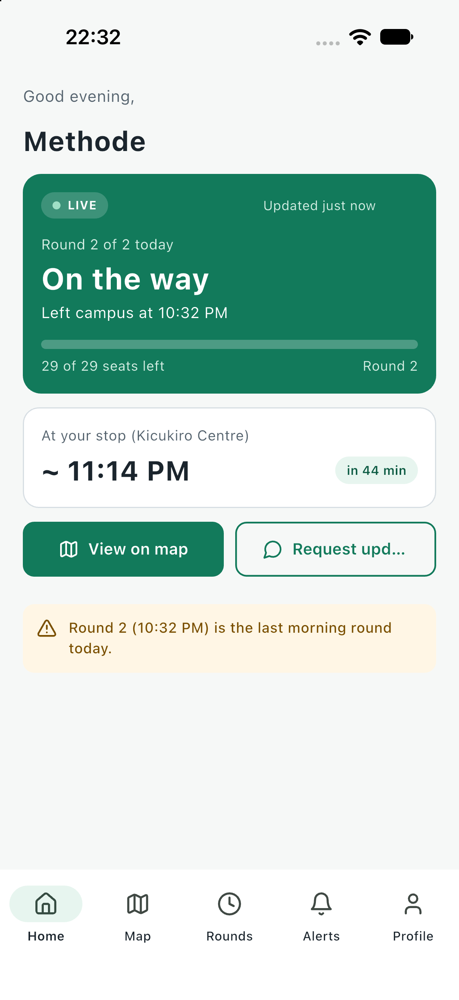<br><sub>Student home</sub></td>
  </tr>
  <tr>
    <td align="center">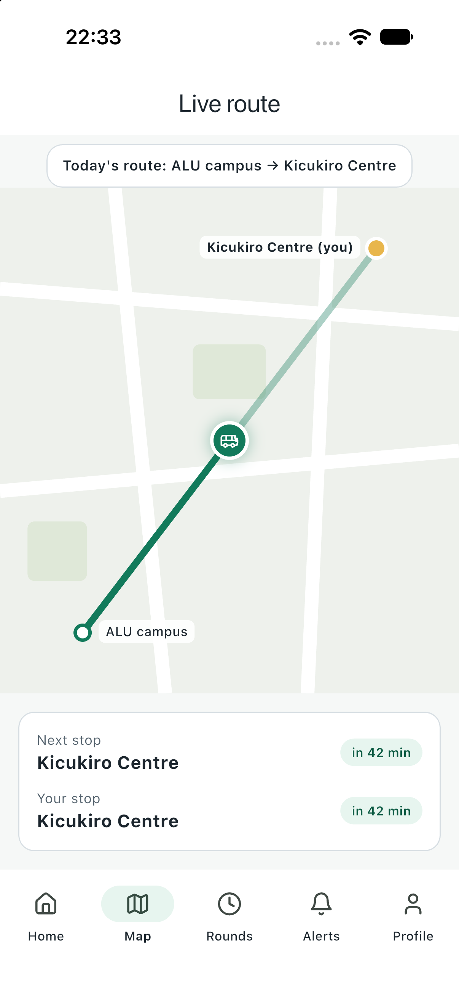<br><sub>Live route map</sub></td>
    <td align="center">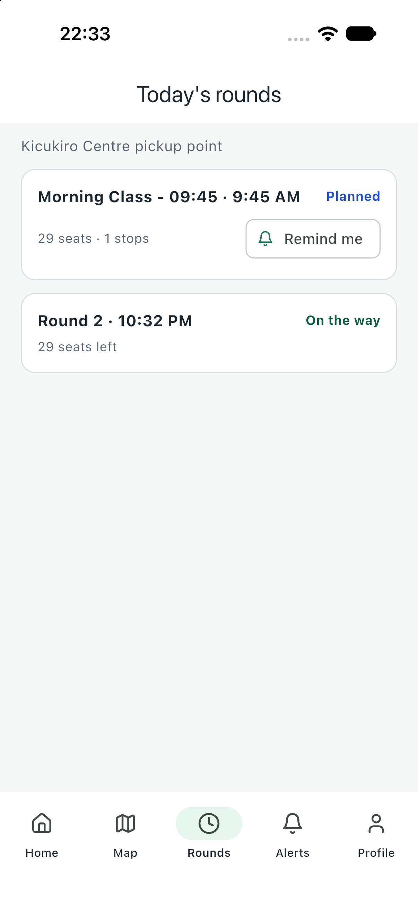<br><sub>Rounds and seats</sub></td>
    <td align="center">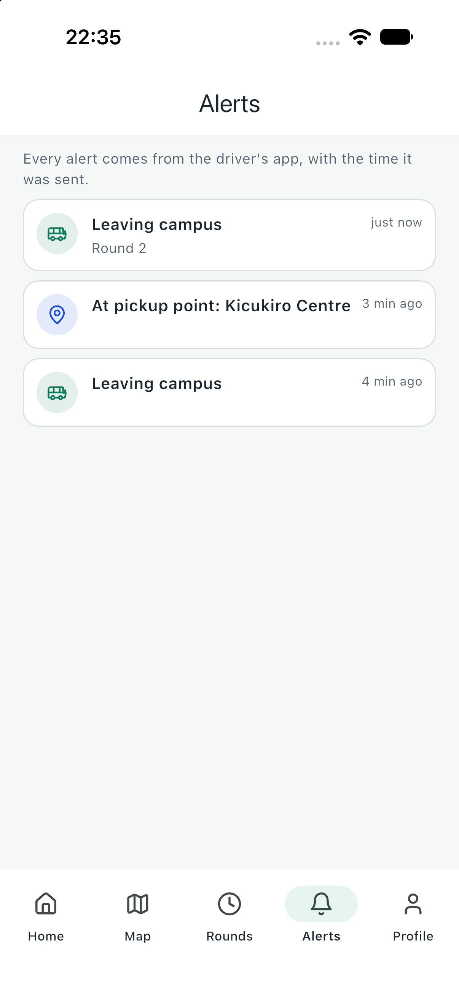<br><sub>Alerts</sub></td>
  </tr>
  <tr>
    <td align="center">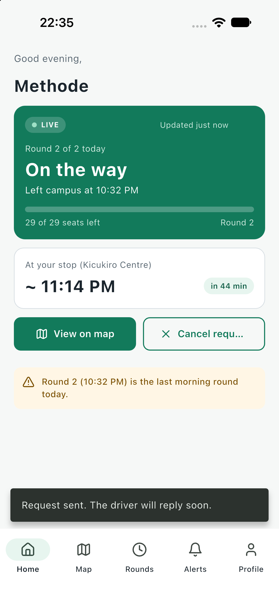<br><sub>Request an update</sub></td>
    <td align="center">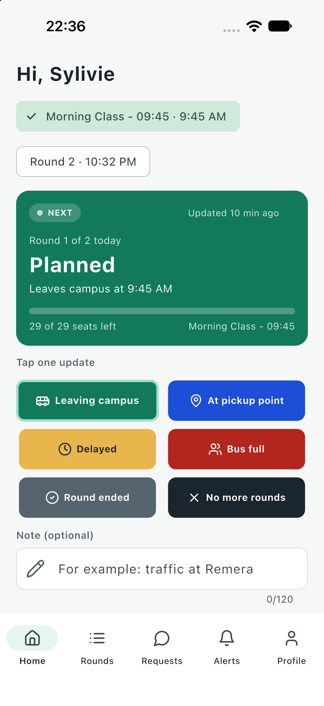<br><sub>Driver home</sub></td>
    <td align="center">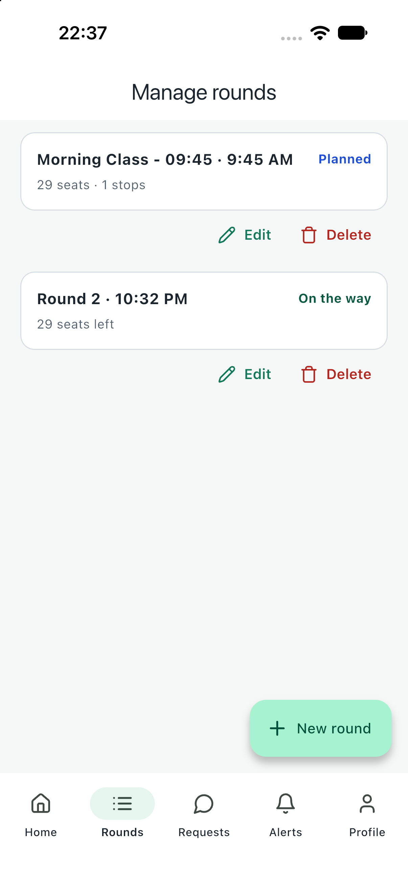<br><sub>Manage rounds</sub></td>
  </tr>
  <tr>
    <td align="center">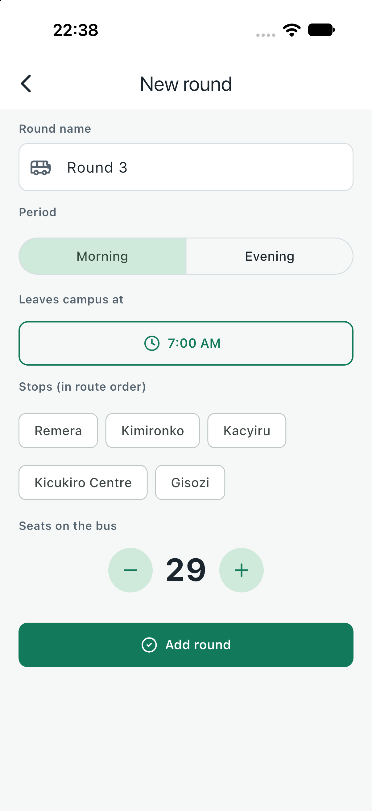<br><sub>Create or edit a round</sub></td>
    <td align="center">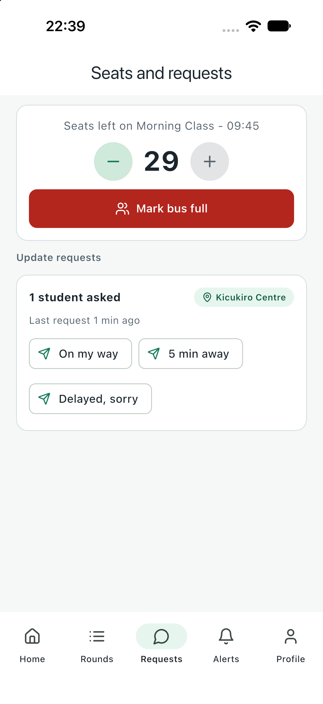<br><sub>Seats and requests</sub></td>
    <td align="center">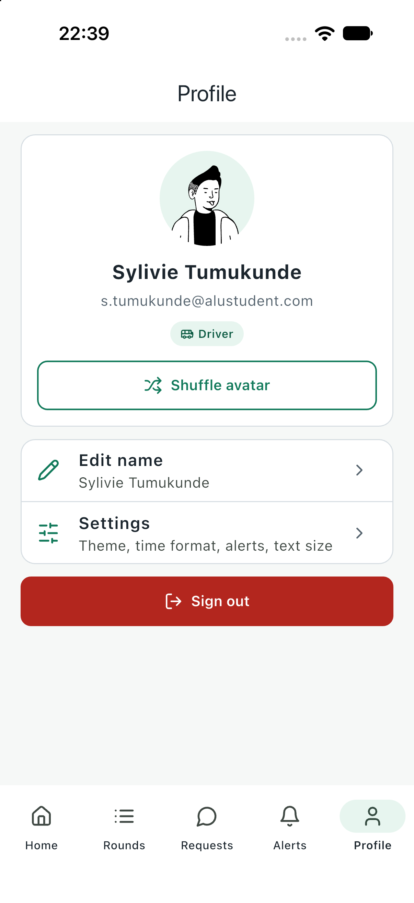<br><sub>Profile</sub></td>
  </tr>
  <tr>
    <td align="center">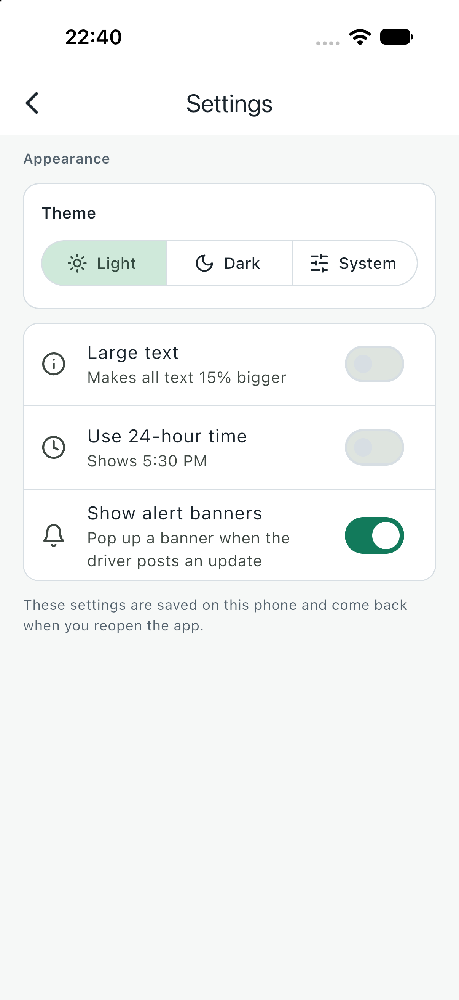<br><sub>Settings</sub></td>
    <td align="center">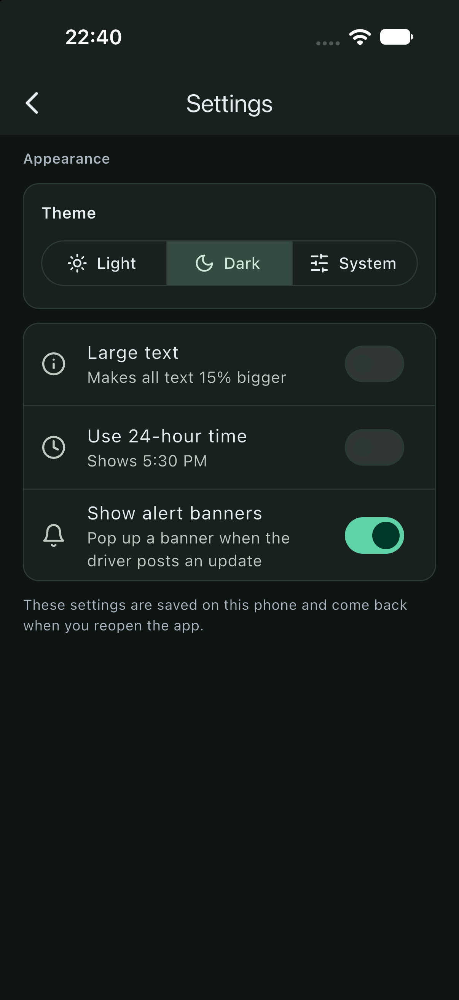<br><sub>Dark mode</sub></td>
    <td align="center">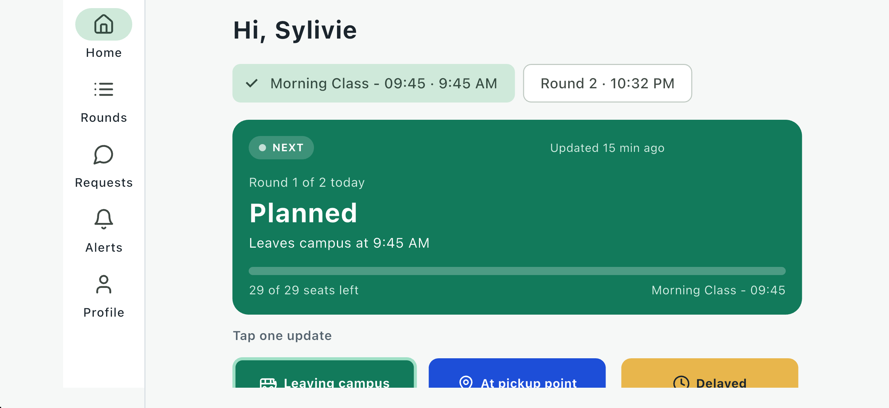<br><sub>Landscape</sub></td>
  </tr>
</table>

## Demo video

**Watch the demo video:** https://youtu.be/nUmkU8nDRY4?si=vD68FbxvpIBeV1j3

## Architecture

We used **Clean Architecture** with one folder per feature. Each feature has three layers:

| Layer | What it holds | Depends on |
|---|---|---|
| `domain` | Entities, repository contracts (abstract classes) and pure rules such as arrival times | Nothing (plain Dart) |
| `data` | Models with `fromMap` / `toMap`, and Firestore, Firebase Auth or SharedPreferences repositories | `domain` |
| `presentation` | Cubits, states, pages and widgets | `domain` |

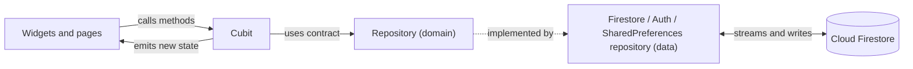

Data always flows one way: **Firestore → repository → Cubit → widget**. Widgets never call Firebase directly. All repositories are created once in `lib/app/app.dart` and given to the cubits (dependency injection), so they are easy to replace with fakes in tests.

```
lib/
├── main.dart                 Starts Firebase and SharedPreferences
├── firebase_options.dart     Generated by FlutterFire
├── app/                      App root, dependency injection, auth gate, session listener, shells
├── core/                     Theme, SVG icons, shared widgets, validators, formatters
└── features/
    ├── auth/                 Email/password, Google sign-in, verification, reset
    ├── profile/              Users, pickup points, setup and profile screens
    ├── rounds/               Rounds, reminders, student home, rounds screen
    ├── map/                  Drawn route map and bus position maths
    ├── alerts/               Driver status updates and the alerts screen
    ├── requests/             Student update requests and driver replies
    ├── driver/               Driver home, round form, seats and requests screens
    └── settings/             SharedPreferences settings and the settings screen
test/                         Unit and widget tests, same folders as lib/
docs/                         ERD, testing guide and screenshots
firestore.rules               Security rules
firestore.indexes.json        Composite indexes
```

Rules that do not need Flutter or Firebase live in `domain/services` so we can unit test them:

- `RoundEta` works out when the bus reaches each stop, which stops it has passed and which round to show.
- `RouteGeometry` places the stops and the bus on the drawn map.
- `LiveChange` decides what each driver update changes on the round (status, current stop, seats).

## State management

We used **flutter_bloc** with **Cubits** for all app state. No screen uses `setState` for app data.

| Cubit | Job |
|---|---|
| `AuthCubit` | Follows the Firebase session: signed out, needs verification, signed in |
| `ProfileCubit`, `PickupPointsCubit` | Live user profile and the list of pickup points |
| `RoundsCubit`, `RemindersCubit` | Today's rounds and the student's reminders, live from Firestore |
| `AlertsCubit` | Driver updates, newest first, with delete |
| `StudentRequestCubit`, `DriverRequestsCubit` | Update requests and replies |
| `DriverRoundCubit` | Posting updates, seats and creating or editing rounds |
| `SettingsCubit` | Theme, text size, time format and alert banners |
| `ShellTabCubit` | Selected tab in the bottom bar or navigation rail |

`AuthGate` picks the first screen from the auth and profile state (splash, login, verify email, setup, or the student or driver tabs). Because the screen comes from state and is not pushed, the back button can never return to the login screen after signing in. `SessionListener` starts every Firestore stream when a user signs in and stops all of them on sign out, so no data from one account is ever shown to the next.

## Database design (ERD)

<div align="center">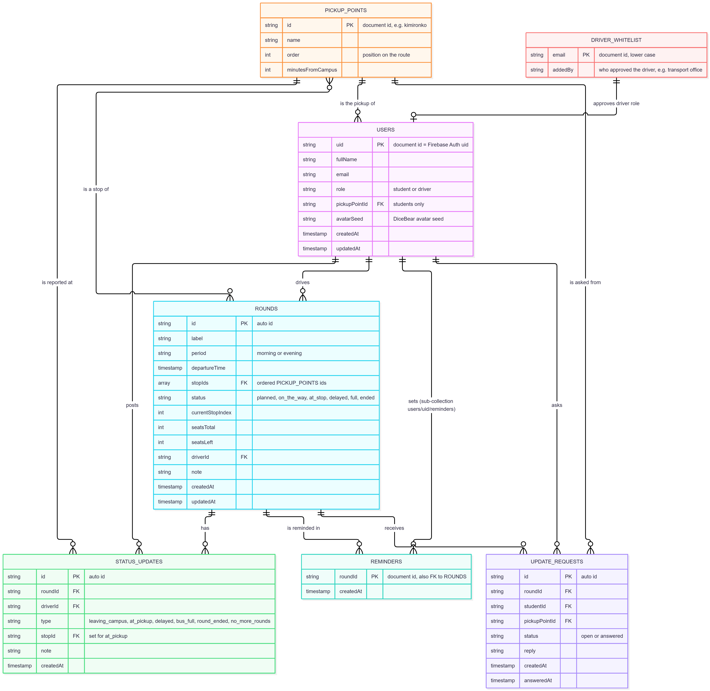</div>

| Collection | What it stores |
|---|---|
| `users/{uid}` | Name, email, role, pickup point and avatar seed. The document id is the Firebase Auth uid. |
| `users/{uid}/reminders/{roundId}` | Rounds the student wants to be reminded about |
| `pickup_points/{id}` | Stop name, order on the route and minutes from campus |
| `rounds/{id}` | Label, departure time, stops, live status, current stop and seats |
| `status_updates/{id}` | Every update the driver posts, used for alerts |
| `update_requests/{id}` | A student's request for an update and the driver's reply |
| `driver_whitelist/{email}` | Emails approved by the transport office to register as drivers |

The full diagram and the field list are in [`docs/erd.md`](docs/erd.md). The field names in the ERD are the same as in Firestore and in every `toMap()`.

## Security

All rules are in [`firestore.rules`](firestore.rules).

- Every user must be signed in, and email/password users must verify their email before they can write.
- A student can only read and change their own profile and reminders. The role and email can never be changed after setup.
- A user can only become a driver if their email is in `driver_whitelist`. Nobody can write to that list from the app.
- Only drivers can create rounds and post updates, and a driver can only change or delete **his own** rounds.
- Every write is checked field by field: allowed keys only, correct types, seats between 0 and the total, notes of 120 characters or less.
- A driver can only add a reply to a student's request. He cannot change who asked or for which round.

## Getting started

### 1. Requirements

- Flutter 3.38 or newer and Dart 3.10 or newer (`flutter --version`)
- An Android emulator or phone, or Xcode and the iOS simulator on a Mac
- Firebase CLI (`npm install -g firebase-tools`) and FlutterFire CLI (`dart pub global activate flutterfire_cli`), only if you want to use your own Firebase project

### 2. Get the code

```bash
git clone https://github.com/dumethode/alu-transport.git
cd alu-transport
flutter pub get
```

### 3. Firebase

The app is already connected to our Firebase project, **`alu-transport-g17`**, through `lib/firebase_options.dart`, `android/app/google-services.json` and `ios/Runner/GoogleService-Info.plist`. To run it on your own project instead:

1. Create a Firebase project and turn on **Authentication → Email/Password** and **Google**.
2. Create a **Firestore** database in production mode.
3. Run `flutterfire configure --platforms=android,ios`.
4. For Google sign-in on Android, add your debug SHA-1 (`cd android && ./gradlew signingReport`) in **Project settings → Your apps → Android**, then download the new `google-services.json` into `android/app/`.
5. Deploy the rules and indexes:

   ```bash
   firebase deploy --only firestore --project <your-project-id>
   ```

6. Approve a driver: in Firestore, create the collection `driver_whitelist` with a document whose **id** is the driver's email in lower case. Add any field, for example `name`.

### 4. Run

```bash
flutter run                # emulator, simulator or connected phone
flutter build apk --release
```

> **First run:** sign in with an approved driver account first. The first driver sign-in adds the five default pickup points, so students can choose one during setup.

## Testing and code quality

```bash
dart format lib test
flutter analyze            # No issues found!
flutter test               # 75 tests, all passing
flutter test --coverage    # writes coverage/lcov.info
```

| Area | Tests |
|---|---|
| Core | Validators and formatters (unit) |
| Settings | Preferences are saved and restored (unit) |
| Auth | `AuthCubit` (unit) and the login screen (widget) |
| Profile | User model mapping and `ProfileCubit`, including a refused driver (unit) |
| Rounds | `RoundEta`, `RoundModel` (unit) and the live status card and round tile (widget) |
| Map | `RouteGeometry` (unit) |
| Alerts | `AlertsCubit` (unit) and the alert tile (widget) |
| Requests | `StudentRequestCubit` (unit) |
| Driver | `LiveChange`, `DriverRoundCubit` (unit) and the seats stepper (widget) |

The tests use fake repositories, so they run without Firebase or the internet. Line coverage is 79.9% for the domain services and Cubits, and 74.4% across all code loaded by the tests. The full list and how to read the coverage report are in [`docs/testing.md`](docs/testing.md).

## How we worked as a team

- **One branch per member** (`methode`, `keira`, `sylivie`, `aliyah`, `cindy`). Nobody pushed straight to `main`.
- **Pull requests for every merge.** Each PR was reviewed by another member before it was merged with a merge commit, so the history shows who did what.
- **Small commits with clear messages** in the Conventional Commits style, for example `feat(rounds): add RoundModel Firestore mapping` or `test(driver): LiveChange, DriverRoundCubit, requests and stepper tests`.
- **Before every commit** we ran `dart format`, `flutter analyze` and `flutter test`.

## Team

| Member | GitHub | Main contribution |
|---|---|---|
| Methode Duhujubumwe | [@dumethode](https://github.com/dumethode) | Project setup, theme and shared widgets, settings (SharedPreferences), navigation and app shells, Firebase setup, security rules, README |
| Keira Mutoni | [@keira9](https://github.com/keira9) | Authentication (email/password, Google, verification, reset) and testing |
| Sylivie Tumukunde | [@T-Sylivie](https://github.com/T-Sylivie) | Database design (ERD), users and pickup points, setup, profile and alerts screens |
| Nirere Aliyah Sayinzoga | [@nirere123](https://github.com/nirere123) | Rounds and reminders, student home and the live route map |
| Cindy Saro Teta | [@TetaCindy](https://github.com/TetaCindy) | Update requests, status update data and all driver screens |

## Known limitations and next steps

| Now | Next |
|---|---|
| The bus position comes from the driver's updates, not live GPS. | Add the driver's GPS location when he allows it. |
| Alerts show while the app is open. | Push notifications with Firebase Cloud Messaging when the app is closed. |
| Rounds are created each day. | A weekly timetable that creates rounds automatically. |
| One bus and one route. | Several buses and routes. |

---

<div align="center">
Made with care by Group 17 at the African Leadership University, Kigali.
</div>
