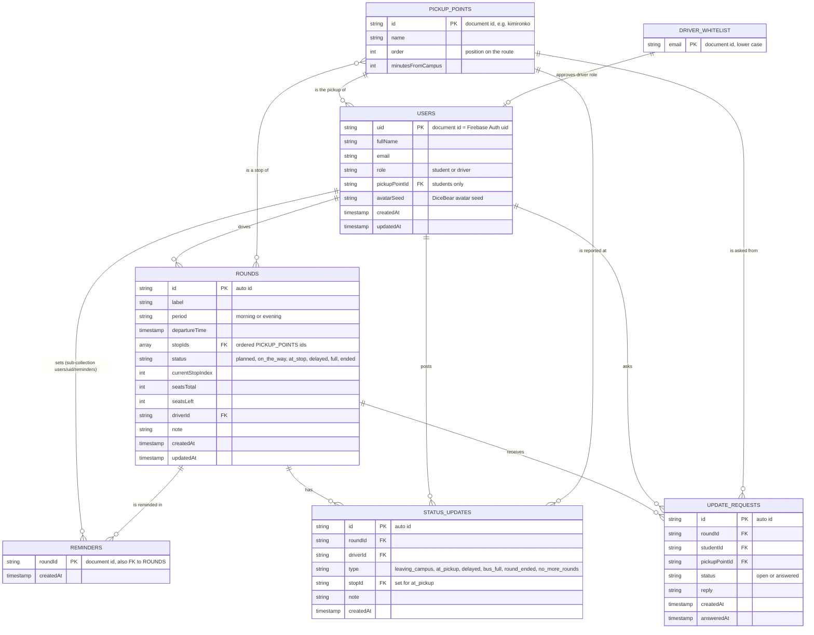

# ALU Transport: Entity Relationship Diagram

The diagram matches the Firestore collections exactly. Field names in the
diagram are the field names in Firestore and in the `toMap()` methods.

## How the ERD maps to Firestore

| Entity           | Firestore path                    | Who can write (see `firestore.rules`)                                   |
| ---------------- | --------------------------------- | ----------------------------------------------------------------------- |
| USERS            | `users/{uid}`                     | Only the owner. Role and email cannot change after setup.               |
| REMINDERS        | `users/{uid}/reminders/{roundId}` | Only the owner. Doc id = round id, so no duplicates.                    |
| PICKUP_POINTS    | `pickup_points/{id}`              | Drivers only. Everyone signed in can read.                              |
| ROUNDS           | `rounds/{id}`                     | The driver who owns the round. Seats must stay between 0 and the total. |
| STATUS_UPDATES   | `status_updates/{id}`             | Drivers create and delete their own; nobody edits.                      |
| UPDATE_REQUESTS  | `update_requests/{id}`            | Students create and delete their own; the driver can only add a reply.  |
| DRIVER_WHITELIST | `driver_whitelist/{email}`        | Nobody from the app. The transport office adds emails in the console.   |

No data is copied between collections. Names (stop name, round name, driver
name) are looked up by id when a screen shows them.

## Indexes

Two composite indexes are in `firestore.indexes.json`:

1. `update_requests`: `status` ascending, `createdAt` descending (driver's open requests).
2. `update_requests`: `studentId` ascending, `createdAt` descending (a student's own requests).

All other queries use one field only, which Firestore indexes automatically.
